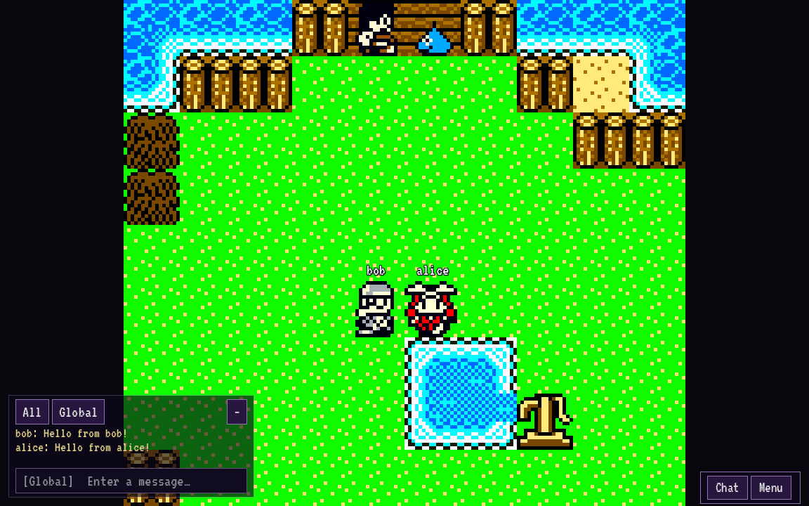

# DQM Online

An open-source Windows, Linux and Android client for playing a locally supplied
**Dragon Warrior Monsters 2: Cobi’s Journey (USA)** ROM with an online HUD,
nearby players, chat and account-based server adventures.

**Development alpha · 0.2.4 · November 5, 2026**

[GitHub](https://github.com/HelloSpaghettiBot/DQM-Online-) ·
[Play & download](https://403world.com/DQM/) ·
[Server status](https://403world.com/DQM/server/) ·
[Project disclaimer](DISCLAIMER.md) ·
[Build instructions](docs/BUILD.md) ·
[Verified results and limits](docs/TEST_RESULTS.md)

> **Unofficial fan project.** DQM Online is not affiliated with, endorsed,
> sponsored or approved by Square Enix, Nintendo, or the original game's rights
> holders. No commercial ROM or playable extracted game assets are included.
> Supply only a compatible ROM you have the legal right to obtain and use.
> Do not upload ROMs or private saves to this repository. Read [DISCLAIMER.md](DISCLAIMER.md).



The original campaign runs inside Gambatte. The Godot client adds the online
interface, account login, presence display and synchronization. This is an
early alpha: original online battles, trades and multiplayer breeding have
**not** been verified end to end. The project is working toward a fuller MMO
experience; the current client is not a finished equivalent of PokeMMO.

## What works today

| Area | Current behavior |
| --- | --- |
| Platforms | Windows x64, Linux x64 and Android arm64 exports. Linux has been run; physical Windows/Android testing is pending. |
| Accounts | Registration and login directly in the client, plus website registration. Public login uses HTTPS and one-use WSS tickets. |
| Original campaign | Uses your compatible local ROM. New hosted adventures begin at the family farm after the boat intro. |
| Progress | Three adventures per account; server SRAM and exact emulator checkpoints. Autosaves every five seconds. Quit, logout and adventure changes wait for confirmation. |
| Online requirement | The campaign requires login and a loaded server adventure. A lost connection stops gameplay. |
| Shared presence | Nearby players and names above characters, verified in the starter area. Whole-campaign map/instance coverage is unfinished. |
| Chat | Chat stays open while moving. Typing captures keyboard input; Android controls leave the text field without closing chat. |
| Desktop interface | Keyboard/gamepad input and an uncluttered HUD. The player list is in Menu → Players. No virtual emulator buttons. |
| Android interface | Large multitouch D-pad, A/B/Start/Select, optional analog stick, saved control sizing and screen stretch. |
| Updates | Automatic verified downloads. Desktop replacement/restart has rollback; Android opens the system installer for confirmation. |
| Experimental links | Consented Challenge/Trade/Breed invitations and a generic emulated cable relay. These do not establish original-game transaction compatibility. |

The Android app name and desktop title are **DQM Online**. **luls.lol** appears
on the startup splash. The public website and game service are at **403world.com/DQM**.

## Install and play

1. [Download your client](https://403world.com/DQM/#download).
2. On Windows/Linux, extract the entire ZIP to a writable folder and keep its
   files together. Run `DQMOnline.exe` on Windows or `DQMOnline.x86_64` on Linux.
   On Android, install the `DQMOnline-android.apk` alpha.
3. Follow the ROM prompt and select your own unmodified Cobi’s Journey USA
   `.gbc` file or a ZIP containing one compatible ROM. The ROM stays on your
   device; a private validated copy is retained for future launches.
4. Create an account in the client or sign in through **Menu → Account**.
   The public host is `403world.com`. Browser login is not required.
5. Choose an adventure. Existing server progress is preserved; a new hosted
   adventure starts at the family farm.

The supported ROM has internal title `DWM2-C`, game code `BQLE`, and SHA256
`8e38a7420ef5239c7196aa4fd4b1499e65db2823e875bbf8241bb2199e766d4e`.
The importer rejects unknown or modified variants. Japanese Iru and Caravan
Heart are not substitutes for the currently supported client.

### Controls

| Action | Keyboard |
| --- | --- |
| Move | Arrows or WASD |
| A / confirm | Z |
| B / back | X |
| Start | Enter |
| Select | Backspace |
| Game menu | Escape |

Gamepads support the D-pad/left stick, A/B, Start and Back. Android uses its
on-screen controls. **Menu → Settings** offers analog/D-pad selection, control
size and full-screen stretch. Disable stretch to keep the original aspect ratio.

**Menu → Players** opens the roster and experimental invitations.
**Menu → Project notice & licenses** opens the fan-project notice and source links.

### Saves and connections

Progress belongs to your server account and adventure slot. Sign in on another
device, supply its local ROM and choose the same adventure to continue. There
is no manual “Save to server” button and no offline campaign mode.

Unexpected disconnections resume the last confirmed checkpoint; activity after
that checkpoint may be lost. Old local `.state` and `.srm` files are ignored
and left untouched. Local files retain your ROM/preferences, not active campaign
progress. Android updates and app suspension are handled around server saves.

A desktop update needs a writable installation folder. Android still requires
the operating system's installation confirmation. The APK is a **debug-signed
alpha**, not a production store release. Older 0.1 clients need one manual
upgrade before automatic updates are available.

## What is still being built

The target is one MMO: optional local ROMs expand the shared world and keep the
same account/character, rather than separate emulator campaigns. Iru (GBC) and
Caravan Heart (GBA) identities are verified; their region/content integration is
not yet playable. Menu → Optional ROMs can import and retain both sources locally;
imports do not unlock their regions yet. See [optional expansions](docs/EXPANSIONS.md).

- Campaign-wide presence, procedural key-world identity, camera/occlusion and
  transition behavior beyond the verified areas.
- Original-game online PvP, monster/key trading and multiplayer breeding.
  A generic cable-byte test is not proof that these transactions work.
- New-adventure setup: optional full intro skip and a level-1 starter from
  ordinary first-world encounters. This selection flow is still in development;
  see [starter requirements](docs/STARTERS.md).
- Parties: follow the leader into the same world without owning its key;
  independent battles; EXP split evenly among members in that world;
  individual loot. See [the agreed party requirements](docs/PARTIES.md).
- Server-side validation of movement, monsters, rewards and the economy.
- Physical Windows and Android play, keyboard/install flows and ergonomics.

The current server owns identity, sessions and save revisions. Original battle
and monster simulation still runs in the client. This is **not a cheat-resistant,
server-authoritative economy**. Do not assume an experimental exchanged monster
is safe until the original-game transaction is verified.

## Build from source

Pinned tools and dependencies:

- Godot **4.6.3 stable**, standard GDScript build.
- Python 3.12+, SCons **4.11.1**, and a C++17 compiler.
- Gambatte and godot-cpp revisions/checksums pinned in `tools/bootstrap.py`.
- godot-sqlite **v4.8** for the server.

Linux bootstrap and local server:

```sh
python3 tools/bootstrap.py --downloads /path/to/downloads
python3 tools/run.py server --dev
```

In two other terminals, explicitly supplying your own ROM:

```sh
python3 tools/run.py client --dev-account alice --rom /path/to/cobi.gbc --connect
python3 tools/run.py client --dev-account bob --rom /path/to/cobi.gbc --connect
```

The local server binds loopback and uses generated development keys. It must
not be exposed as the public service. Public clients use password login over
HTTPS followed by a short-lived one-use ticket over WSS.

```sh
# Connect to the hosted service using your own local ROM
python3 tools/run.py client --rom /path/to/cobi.gbc

# Open the editor
python3 tools/run.py editor

# Inspect a local ROM or single-ROM ZIP without changing it
python3 tools/rom_inspector.py /path/to/cobi.gbc
```

Set `GODOT=/path/to/godot` to override the engine path; the runner checks the
pinned version. Bootstrap downloads/builds dependencies and imports the projects.
It does not download commercial ROMs or run gameplay tests.

See [docs/BUILD.md](docs/BUILD.md) for Linux, Windows and Android builds,
[docs/VPS_DEPLOYMENT.md](docs/VPS_DEPLOYMENT.md) for hosting/backups, and
[docs/UPDATER.md](docs/UPDATER.md) for release/update handling. A self-hosted farm
starter must be produced privately from your own lawfully usable ROM. No starter
save is included in source or client downloads.

## Verification

Tests are explicit developer tools and do not run during normal game startup.

```sh
python3 -m unittest discover -s tests -v
python3 tests/run_network.py
python3 tests/run_network.py --cable
python3 tests/run_accounts_network.py
```

The cable check uses a tiny independently authored GBC hardware program. ROM
probes require explicitly supplied private fixtures. Two-client movement/chat
captures can be generated with `tests/capture_clients.py`; use `--help` for its
required ROM and checkpoint inputs. Run output belongs outside public source.

[docs/TEST_RESULTS.md](docs/TEST_RESULTS.md) distinguishes actual successful
checks from unverified behavior and physical-device limits.

## Repository structure

| Path | Purpose |
| --- | --- |
| `client/` | Godot game HUD, accounts, ROM import, input, updater and presence adapter |
| `native/` | C++ GDExtension and emulator bridge |
| `server/` | Authenticated sessions, chat, invitation relay and SQLite saves |
| `shared/` | Common RPC and release declarations; copied into both projects by the runner |
| `web/` | Retro website, registration/login API, downloads and server status |
| `tools/` | Dependency setup, development runner, ROM inspection and sanitized packaging |
| `tests/` | Unit checks, actual protocol processes and opt-in local-ROM probes |
| `deployment/` | Isolated systemd/nginx setup, release switching and private backups |
| `docs/` | Build, architecture, protocol, research, legal notes and validation |

Corresponding patched Gambatte/godot-cpp sources accompany the sanitized source
archive under `.vendor/`. Generated libraries, SDKs, caches and private files do
not belong in the public repository. Exact source revisions and patch generation
are documented by the bootstrap/build tools.

## Contributing and reporting bugs

Open an issue with the client version, platform, reproduction steps and expected
behavior. Remove account names where unnecessary and never post passwords,
tickets, signing keys, database files, private saves or ROMs. Do not request or
link unauthorized game downloads. A ROM checksum and plain description of the
area are enough to identify compatibility; the ROM itself is not needed.

Contributions should preserve the original campaign engine, online-only server
progress, uncluttered desktop HUD and usable Android controls. Keep experimental
features labeled honestly and document meaningful verification.

See [CONTRIBUTING.md](CONTRIBUTING.md) and [SECURITY.md](SECURITY.md).

## License and rights

Project software is **GPL-2.0**; read [LICENSE](LICENSE) and
[THIRD_PARTY_NOTICES.md](THIRD_PARTY_NOTICES.md). Third-party notices and licenses
remain with their components. Original game rights, trademarks, music and
screenshots are not licensed by this project's GPL. Website screenshots depict
the original game and are presentation images, not playable asset packs.

Public source and client packages exclude commercial ROMs, playable extracted
assets, private starter saves, account databases, passwords/tickets, private
logs, instruction files and signing keys. The local-ROM requirement and this
notice do not guarantee legal protection. Read [DISCLAIMER.md](DISCLAIMER.md)
for the complete project notice.
